<div align="center">

<picture>
  <source media="(prefers-color-scheme: dark)" srcset="docs/brand/counterweight-on-dark.svg" />
  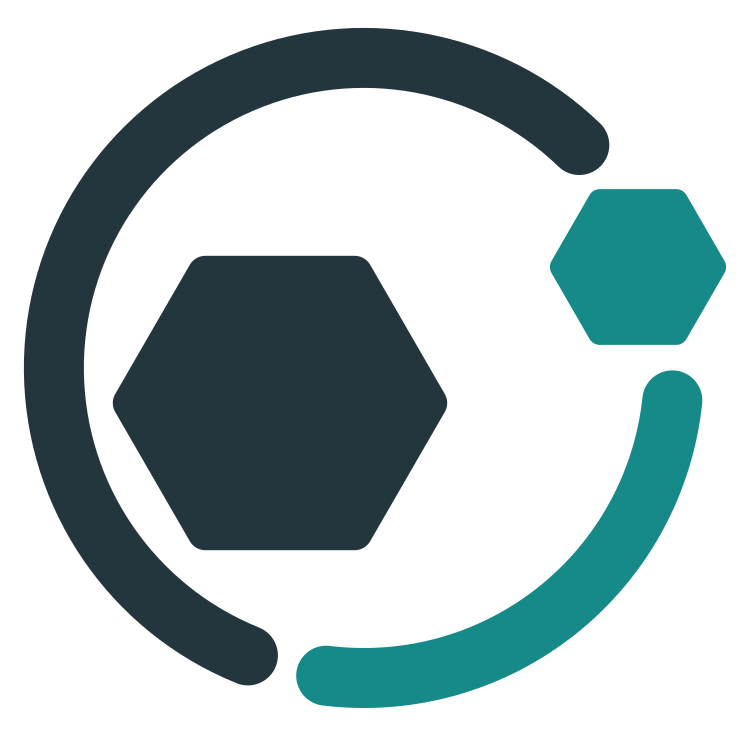
</picture>

# Counterweight

**Encuentra y corrige tus debilidades antes de que lo haga un atacante.**

Evaluaciones de seguridad autoalojadas y asistidas por IA sobre tus aplicaciones en ejecución y tu código fuente:<br />
los agentes hacen el trabajo, una persona aprueba los pasos riesgosos, y cada hallazgo termina en una corrección verificada,<br />
un informe que tus auditores pueden leer y un ticket sobre el que tus desarrolladores pueden actuar.

[](LICENSE)
[](go.mod)
[](https://github.com/Philocyber/counterweight/actions/workflows/ci.yml)
[](https://github.com/Philocyber/counterweight/releases)

[English](README.md) | **Español**

[Inicio rápido](#inicio-rápido) · [Primera evaluación](#tu-primera-evaluación) · [Funciones](#funciones) · [Configuración](#configuración) · [Documentación](#documentación) · [Uso responsable](#uso-responsable)

</div>

---

## Por qué Counterweight

Los atacantes ya automatizan con IA: modelos baratos y agentes autónomos le permiten a un grupo
pequeño analizar una organización con más profundidad de la que esa organización jamás usó para
probarse a sí misma. Los equipos de seguridad con mucho presupuesto pueden seguir el ritmo. La
mayoría de las empresas no puede: no tiene red team, ni SOC, ni presupuesto para pentests.

Un contrapeso devuelve el equilibrio a un sistema desbalanceado. Este proyecto pone la misma clase
de herramientas del lado de quienes defienden: código abierto, autoalojado, ejecutándose en tus
máquinas con el modelo que elijas, para que un equipo de TI de dos personas o una startup en
crecimiento encuentre y corrija sus debilidades antes que nadie. ([Más sobre la misión y sus
fuentes](docs/why-counterweight.md), en inglés.)

<p align="center">
  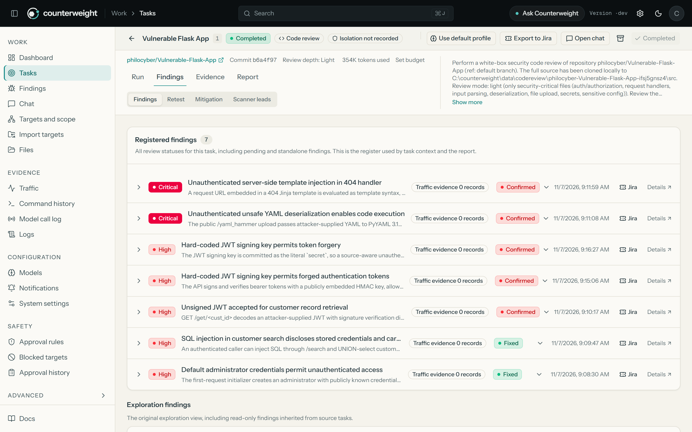
</p>

<details>
<summary><b>Más de la misma revisión de demostración</b> (pull request con el fix, grafo de exploración, reporte)</summary>
<br />

| Fix verificado y mergeado como pull request | Cómo exploraron el código los agentes |
| :---: | :---: |
| 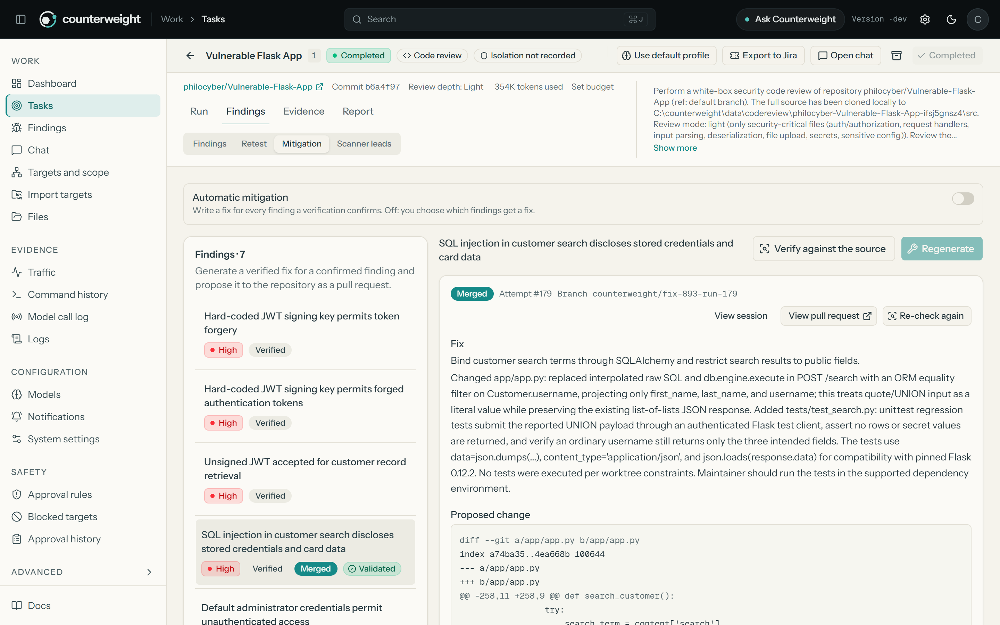 | 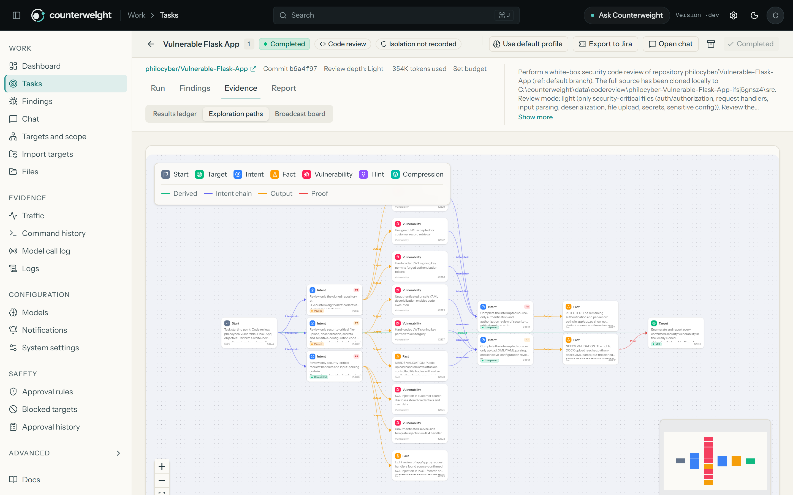 |

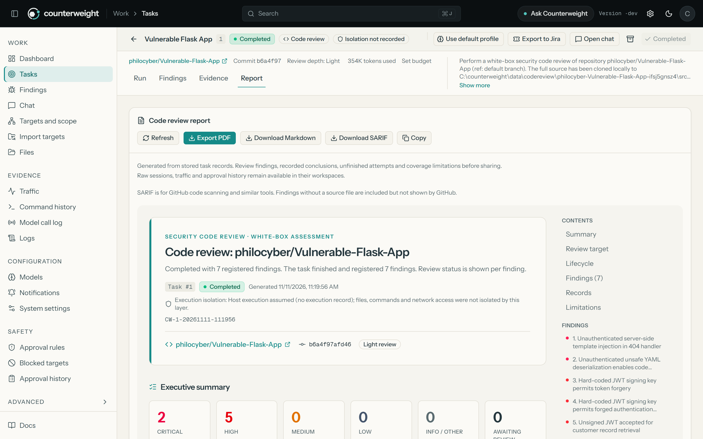

</details>

<p align="center"><sub>Demo: revisión white-box de <a href="https://github.com/philocyber/Vulnerable-Flask-App">philocyber/Vulnerable-Flask-App</a>, una app de entrenamiento intencionalmente vulnerable. Se omiten los detalles del modelo y del host.</sub></p>

<p align="center">
  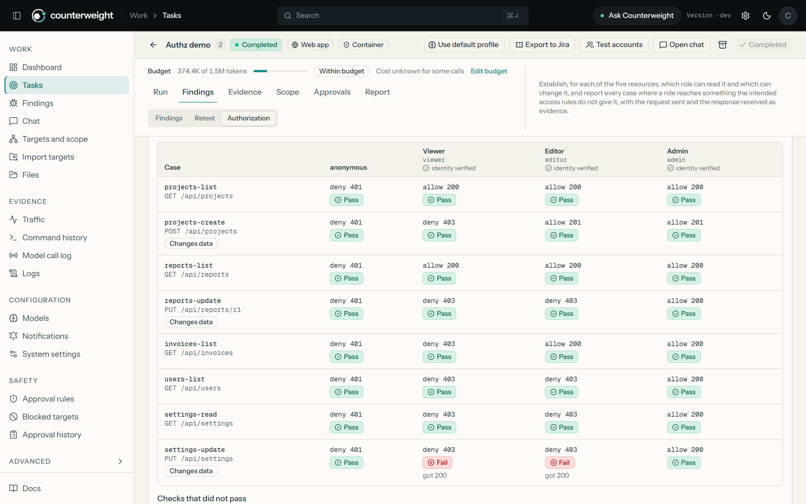
</p>

<details>
<summary><b>Más de la demostración de aplicación web</b> (cuentas de prueba por rol, un agente probando como cada rol)</summary>
<br />

| Cuentas de prueba guardadas en la tarea, por rol | Un agente enviando peticiones como cada rol |
| :---: | :---: |
| 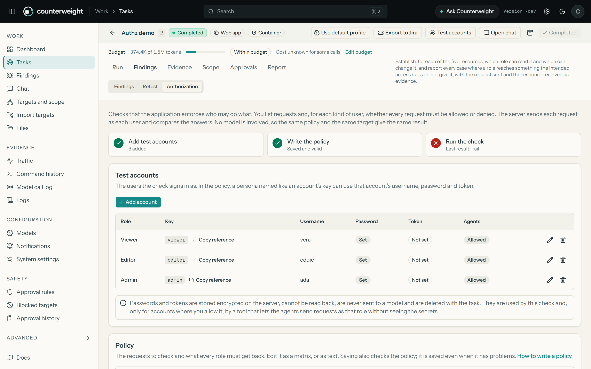 | 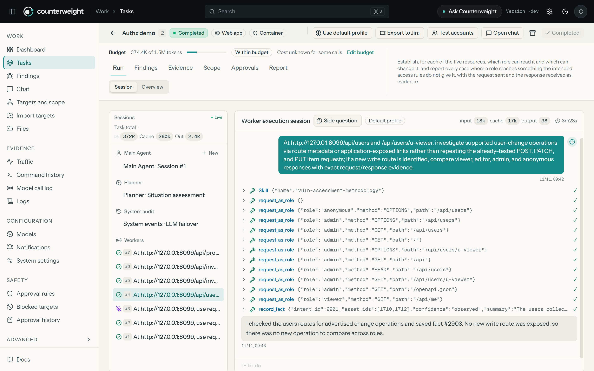 |

</details>

<p align="center"><sub>Demo: una aplicación local de prueba con cinco recursos y tres niveles de acceso. La verificación de autorización, que no usa modelo, detectó la falla que su política lista; los agentes, enviando peticiones como cada rol guardado sin recibir sus credenciales, encontraron dos que la política no lista.</sub></p>

## Qué hace

Counterweight cubre el ciclo completo, no solo el hallazgo:

| Paso | Qué ocurre |
| --- | --- |
| **Evaluar** | Eliges qué probar: una aplicación web o API, una red o un repositorio de código. Un planificador y varios workers en paralelo lo exploran paso a paso. Cada tipo de evaluación tiene su propio flujo, agentes y herramientas. |
| **Demostrar** | Con la captura de tráfico activada, los hallazgos de caja negra quedan vinculados al tráfico HTTP capturado que los demuestra. Los de código citan el archivo, las líneas y el camino desde la entrada hasta el punto vulnerable. Después, otro agente intenta refutar cada uno. |
| **Corregir** | Para hallazgos de código, un agente escribe el parche, otro lo revisa y Counterweight abre el pull request. Tras el merge, vuelve a comprobar el código fusionado. |
| **Verificar** | Los retests de un clic responden *sigue reproducible*, *corregido* o *no concluyente* frente a la evidencia original. |
| **Entregar** | Informes en Markdown y PDF (técnico y ejecutivo), SARIF para GitHub code scanning y Jira: una épica por evaluación y una incidencia lista para el desarrollador por hallazgo, actualizadas a medida que llegan las correcciones. |

Y está pensado para que lo opere un equipo pequeño, en sus propias máquinas:

- **Tú decides.** El alcance, las reglas de denegación y la puerta de aprobación retienen los
  comandos riesgosos hasta que una persona decide. Una revisión de código nunca ejecuta el código
  del repositorio, y sus agentes no tienen shell ni herramientas de red.
- **Tus datos son tuyos.** Sin servicio alojado y sin telemetría. Usa un modelo alojado, un gateway
  o un modelo en tu propio hardware, y nada más sale de tu red.
- **Protegido por defecto.** El acceso a archivos de los agentes queda confinado a cada tarea, las
  credenciales guardadas están cifradas y son de solo escritura, las sesiones se pueden revocar y un
  presupuesto por tarea frena el gasto descontrolado.
- **Listo en minutos.** Un instalador, una lista de primeros pasos y una configuración guiada del
  modelo te llevan de `git clone` a tu primera evaluación.

## Inicio rápido

El camino más rápido es Docker Compose con el instalador interactivo. Son pocos comandos; la
primera construcción de la imagen compila Counterweight desde el código fuente e instala un
navegador sin interfaz, así que puede tardar varios minutos. Los arranques siguientes toman
segundos.

**Necesitas:** Git, [Docker](https://docs.docker.com/get-docker/) con Compose v2, una terminal Bash
(Linux, macOS, o WSL / Git Bash en Windows) y una clave de API de un proveedor de modelos (puedes
agregarla después desde la consola).

**1. Descarga el código**

```bash
git clone https://github.com/Philocyber/counterweight.git
cd counterweight
```

**2. Instala y arranca**

```bash
./install.sh        # elige 1) All-in-Docker install
```

El instalador verifica Docker (y ofrece instalarlo en Linux), crea un certificado HTTPS autofirmado
para `localhost` en `tls/` si no tienes uno (con Docker la consola funciona solo por HTTPS), pide
una contraseña para PostgreSQL (Enter genera una aleatoria) y una clave de API de Anthropic
opcional, escribe un `.env` privado, construye la imagen y levanta los servicios.

> [!TIP]
> ¿Prefieres evitar la advertencia del navegador? Antes de ejecutar el instalador, crea un
> certificado de confianza local con [mkcert](https://github.com/FiloSottile/mkcert):
> `mkdir -p tls && mkcert -install && mkcert -cert-file tls/server.pem -key-file tls/server-key.pem localhost 127.0.0.1 ::1`.
> El uso de tu propio certificado se explica en [configuración](docs/configuration.md).

**3. Reclama tu instalación.** Abre **<https://localhost:8787>**. La primera visita lleva a la
página de configuración inicial, que pide el token de un solo uso que mostró el instalador. Para
verlo de nuevo:

```bash
docker compose exec counterweight /app/counterweight -setup-token
```

En Git Bash sobre Windows, antepón `MSYS_NO_PATHCONV=1` a ese comando para que la ruta del
contenedor no se reescriba. Pega el token, elige una contraseña (al menos 8 caracteres), acepta los
Términos de uso e inicia sesión como **`COUNTERWEIGHT`**.

<details>
<summary><b>¿Prefieres ejecutar Docker Compose a mano?</b></summary>

```bash
install -m 600 .env.example .env     # luego define POSTGRES_PASSWORD (y, si quieres, una clave de API)
# antes, coloca un certificado en tls/server.pem y tls/server-key.pem (ver docs/configuration.md)
docker compose up -d --build
```

En Windows PowerShell, crea primero el `.env` con permisos privados:
`powershell.exe -NoProfile -File .\private-credential.ps1 -Path .\.env -Template .\.env.example`.

Compose publica la consola (`8787`) y el proxy de grabación (`8788`) solo en `127.0.0.1`, y guarda
los datos en el volumen `pgdata` y en las carpetas `./data` y `./skills`.
</details>

## Conecta un proveedor de modelos

Los agentes necesitan un modelo. En la consola abre **Modelos → Conectar un modelo**: elige dónde
corre el modelo, completa lo que esa opción necesita, prueba la conexión y guarda. El primer perfil
que guardas queda como activo. Las plantillas completan el formato, la URL base y el modelo por ti;
no se contacta a nadie hasta que pruebes o guardes.

| Opción | Uso típico |
| --- | --- |
| **Anthropic** (Messages API) | Clave de API directa |
| **OpenAI** (Chat Completions o Responses API) | Clave de API directa |
| **Gateways**: Vercel AI Gateway, claves de API de Amazon Bedrock | Una clave, muchos modelos |
| Plantillas de **Z.ai GLM** | Clave de API directa |
| **Cualquier endpoint compatible con OpenAI** | Servidores locales (Ollama, LM Studio, llama.cpp), vLLM propio u otros proveedores |
| **Inicio de sesión con Codex / ChatGPT** | Usa la CLI de Codex en el equipo del backend |

También puedes crear un perfil predeterminado desde `.env` con `ANTHROPIC_API_KEY` u
`OPENAI_API_KEY` (ver [configuración](#configuración)).

¿No sabes cuál elegir, o necesitas que todo quede en tu equipo? La guía
[Elegir y conectar un modelo](docs/choose-a-model.md) (en inglés) compara la inferencia alojada, por
gateway, local y en servidor propio, indica qué necesitan los agentes de un modelo y termina con una
comprobación de cinco minutos para confirmar que el que elegiste funciona. Plantillas de
proveedores, gateways y mensajes de error: [docs/llm-providers.md](docs/llm-providers.md) (en inglés).

> [!NOTE]
> Los prompts, la salida de las herramientas y los datos de los objetivos se envían al proveedor de
> modelos que configures, bajo sus propios términos. Counterweight no tiene un servicio alojado ni
> recopila datos de uso. Elige un proveedor, o un modelo propio, que tu política de datos permita.

## Tu primera evaluación

> [!IMPORTANT]
> Evalúa solo sistemas y código que te pertenezcan o que tengas autorización explícita y por escrito
> para probar. Ver [Uso responsable](#uso-responsable).

La consola está en inglés por defecto; puedes cambiarla a español desde los controles de la barra lateral. Los
nombres de abajo son los de la consola en español. La tarjeta **Primeros pasos** del panel te guía
por estos pasos y los va marcando.

### Revisa el código de un repositorio de GitHub

1. **Tareas → Nueva tarea**, elige **Repositorio de código fuente** y escribe
   `tu-organizacion/tu-repositorio`. Elige la profundidad: `light` (archivos críticos para la
   seguridad), `balanced` (predeterminada) o `comprehensive`. La misma revisión se puede iniciar
   desde **Chat** con `/code-review tu-organizacion/tu-repositorio balanced`.
2. Counterweight clona el repositorio, registra el commit exacto e inicia la revisión. Los
   repositorios públicos no necesitan nada más; para un **repositorio privado**, agrega antes un
   token de GitHub de grano fino con *Contents: read* sobre ese repositorio en
   **Ajustes del sistema → Integraciones**.
3. Sigue la tarea. Los agentes de revisión leen y buscan en el código; no pueden ejecutarlo. Cuando
   terminan, **Pistas de escáneres** muestra lo que marcaron los escáneres incluidos de
   dependencias y de secretos, como pistas que los agentes verifican después, nunca como hallazgos
   por sí solas.
4. En **Hallazgos**, verifica un hallazgo contra el código. En **Mitigación**, genera una
   corrección: un agente aparte la escribe y una revisión automática la comprueba.
5. Para proponer la corrección, dale al token *Contents* y *Pull requests* con lectura y escritura
   y haz clic en **Abrir pull request**. Cuando se fusione, **Reverificar el código fusionado**
   confirma la corrección.

### Prueba una aplicación web que tienes autorizado probar

1. **Objetivos y alcance**: crea una empresa y agrega los hosts, IPs o CIDR exactos que están en
   el alcance.
2. **Reglas de aprobación**: revisa las reglas de denegación integradas y activa la interceptación
   de ejecución de shell, para que los comandos no contemplados esperen tu aprobación. Para
   conservar como evidencia los intercambios HTTP detrás de cada hallazgo, activa la **captura de
   tráfico** en **Ajustes del sistema → Captura de datos**.
3. **Tareas → Nueva tarea**, elige **Aplicación web o API**, describe qué probar y un objetivo
   verificable, por ejemplo *"Evaluación autorizada de staging.example.com: identificar debilidades
   expuestas externamente e informar solo lo confirmado con evidencia."* Opcionalmente fija un
   presupuesto de tokens.
4. Sigue las pestañas **Ejecución** y **Evidencia**, y responde las aprobaciones a medida que
   lleguen.
5. Clasifica los **Hallazgos** (con la evidencia de tráfico vinculada), usa **Reverificar** después
   de una corrección y exporta el **Informe** en PDF, Markdown o SARIF, o envíalo a Jira desde el
   encabezado de la tarea.

Un recorrido completo con un informe de ejemplo: [docs/example-engagement.md](docs/example-engagement.md)
(en inglés).

## Instalación

Docker Compose ([Inicio rápido](#inicio-rápido)) es el camino recomendado. Hay dos opciones nativas
sin contenedores; ambas necesitan PostgreSQL y sirven HTTP simple en `http://127.0.0.1:8787` (solo
loopback).

<details>
<summary><b>Binario publicado (Linux, macOS, Windows)</b></summary>

Descarga `counterweight-<versión>-<sistema>-<arquitectura>.zip` desde
[Releases](https://github.com/Philocyber/counterweight/releases) y compruébalo contra
`SHA256SUMS`. Hay archivos para Linux y macOS (amd64, arm64) y Windows (amd64). Cada uno incluye el
binario con la consola integrada, `start.sh` (o `start.bat`), `skills/`, `config.example.json`, la
documentación y el [adaptador para agentes](adapters/agent/README.md).

¿Todavía no tienes PostgreSQL? Alcanza con un contenedor:

```bash
docker run -d --name counterweight-pg -p 127.0.0.1:5432:5432 \
  -e POSTGRES_USER=counterweight -e POSTGRES_PASSWORD=cambiame -e POSTGRES_DB=counterweight \
  -v counterweight-pg:/var/lib/postgresql/data postgres:16-alpine
```

Luego configura y arranca:

```bash
install -m 600 config.example.json config.json   # define host, puerto (5432), usuario, contraseña y base
./start.sh                                       # Windows: .\start.bat (queda en ejecución)
```

En una segunda terminal, imprime el token de configuración de un solo uso y abre <http://127.0.0.1:8787>:

```bash
./counterweight -setup-token                     # Windows: .\counterweight.exe -setup-token
```

En Windows, crea `config.json` con
`powershell.exe -NoProfile -File .\private-credential.ps1 -Path .\config.json -Template .\config.example.json`.
En lugar de `config.json` puedes definir `COUNTERWEIGHT_PG_DSN`. Arranca siempre con `start.sh` /
`start.bat`: ejecutan el ciclo de reinicio del que dependen las actualizaciones desde la consola.
</details>

<details>
<summary><b>Compilar desde el código fuente</b></summary>

Requiere Go 1.26.3 o superior (ver `go.mod`) y Node.js 22 con npm.

```bash
go run ./cmd/counterweight build      # construye la consola y ./counterweight (counterweight.exe en Windows)
./start.sh                            # Windows: .\start.bat
```

La opción **2) Local run** de `./install.sh` hace lo mismo de forma interactiva y puede levantar
PostgreSQL en Docker por ti. Archivos multiplataforma: `./build.sh --release`. Entorno de desarrollo:
[CONTRIBUTING.md](CONTRIBUTING.md) (en inglés).
</details>

## Funciones

**Evaluar**
- Cuatro tipos de evaluación (aplicación web o API, red y hosts, repositorio de código fuente,
  mixto), cada uno con su propio flujo, agentes, herramientas e informe.
- Motor multiagente: un planificador y N workers en paralelo (3 por tarea por defecto) comparten un
  grafo de activos y un grafo de exploración, así el trabajo de varios pasos se mantiene coherente
  entre sesiones.
- Revisión de caja blanca de repositorios de GitHub públicos y privados en tres profundidades, con
  agentes que pueden leer y buscar en el código pero no ejecutarlo ni acceder a la red.
- Escáneres suplementarios para revisiones de código (avisos de dependencias con OSV-Scanner,
  secretos en el repositorio con Gitleaks). Nunca dirigen la revisión: los agentes terminan primero
  su propio trabajo, después verifican las pistas de los escáneres, y nunca se les informa cuando un
  escáner no encontró nada.
- Revisiones de pull requests: revisa solo lo que introduce un cambio, desde la consola o desde un
  workflow de GitHub Actions que informa en el resumen del job, en code scanning y en el pull
  request, y puede hacer fallar el job si hay hallazgos dentro de las líneas cambiadas
  ([guía](docs/pr-reviews.md), en inglés).
- Verificaciones de autorización sin modelo: una política indica qué rol puede hacer qué petición y
  qué debe recibir cada uno, y Counterweight la reproduce contra staging. Se ejecuta dentro de una
  tarea, con cuentas de prueba guardadas cifradas en la tarea, la política cargada como una matriz
  de peticiones y roles (o escrita como texto) y el resultado por nombre de rol en
  el informe, o desde un job de CI con `counterweight authz`, que falla cuando una ruta queda
  abierta al usuario equivocado. Las credenciales no aparecen en ninguna salida. También puedes
  permitir que los agentes envíen peticiones como un rol guardado: el servidor inicia sesión por
  ellos y nunca reciben las credenciales ([guía](docs/authorization-checks.md), en inglés).
- Un agente de chat que crea tareas, inicia revisiones y responde preguntas sobre los resultados.

**Mantener el control**
- Alcance por tarea con propuestas de cobertura aprobadas por el operador, y objetivos bloqueados
  globales y por tarea.
- Reglas de denegación integradas para comandos destructivos, más tus propias reglas de permitir y
  denegar.
- Puerta de aprobación: las ejecuciones de shell no contempladas esperan a una persona; el modelo no
  puede aprobarse a sí mismo, una revisión automática que falla consulta a una persona y un tiempo
  de espera de cinco minutos deniega. Las retenciones de permiso pausan la tarea y sobreviven a los
  reinicios.
- Presupuesto por tarea en tokens, o en dinero si cargas los precios de tu modelo: la tarea se pausa
  al llegar al límite y continúa cuando lo subes.

**Evidencia**
- Proxy de grabación (apagado hasta que actives la captura de tráfico) que captura el tráfico
  HTTP(S) de los agentes y lo vincula a los hallazgos con roles y notas.
- Registro completo de actividad: sesiones, historial de comandos, registro de llamadas al modelo y
  logs.
- Cada informe indica cómo se ejecutó la tarea, incluido si el acceso a archivos estuvo confinado.

**Corregir y verificar**
- Retests de un clic con un agente dedicado.
- Verificación independiente, generación de correcciones con revisión del parche, pull requests y
  reverificación tras el merge para hallazgos de código.

**Informar y entregar**
- Informes de tarea en Markdown y PDF (variantes técnica y ejecutiva, con credenciales ocultas).
- Exportación SARIF 2.1.0 para GitHub code scanning y otras herramientas, con etiquetas CWE y
  huellas estables ([cómo subirla](docs/features.md), en inglés).
- Jira Cloud: registra una tarea como épica y sus hallazgos como incidencias listas para el
  desarrollador con un clic, en el espacio que elijas, con prioridades y vencimientos según la
  severidad; Counterweight comenta y transiciona las incidencias a medida que las correcciones se
  fusionan y reverifican ([guía](docs/jira.md), en inglés).
- Exportación de hallazgos a Markdown, ZIP, CSV y JSON.

**Seguro por diseño**
- Aislamiento de ejecución, activado por defecto: las herramientas de archivos de cada agente de
  tarea quedan confinadas a los archivos de esa tarea, se comprueba con una autoprueba al arrancar,
  y la tarea no inicia si la comprobación falla.
- Modo contenedor opcional para instalaciones nativas: los comandos de cada tarea se ejecutan en
  su propio contenedor sin privilegios, que no ve el entorno del servidor, sus credenciales ni los
  archivos de otras tareas, y se demuestra con una autoprueba contra un contenedor real antes de
  poder elegir el modo.
- Tokens de API para automatización que solo alcanzan los endpoints de revisión, guardados como
  hash y revocables.
- Las credenciales de integraciones y de modelos son de solo escritura en la consola y se guardan
  cifradas en la base de datos, con una clave que vive fuera de ella.
- Sesiones revocables, cierre de sesión en todos los dispositivos, tickets de un solo uso para los
  flujos en vivo, cabeceras de seguridad del navegador y longitud mínima de contraseña.
- Las actualizaciones se verifican por checksum, y por firma (Ed25519) en las versiones que
  incluyen la clave de publicación del proyecto; una actualización fallida se revierte sola.

**Extender**
- Biblioteca de skills (formato `agentskills.io`), herramientas propias de comando, script y HTTP,
  servidores MCP locales y remotos, notificaciones, importación de activos desde
  [ScopeSentry](https://github.com/Autumn-27/ScopeSentry) y un adaptador para Claude Code, Codex y
  Pi.

**Operar**
- Un binario de Go con la consola incluida, o Docker Compose con un instalador que muestra la
  dirección y el token de configuración de un solo uso.
- Lista de primeros pasos, configuración guiada del modelo y documentación completa dentro de la
  aplicación.
- Consola en inglés y español (los mensajes del backend y los informes están en inglés).

Más detalle: [docs/features.md](docs/features.md) (en inglés).

| Tareas | Hallazgos |
| :---: | :---: |
| 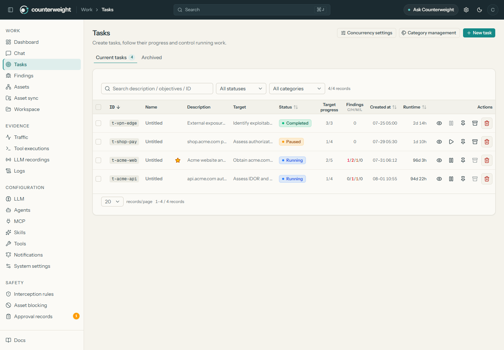 | 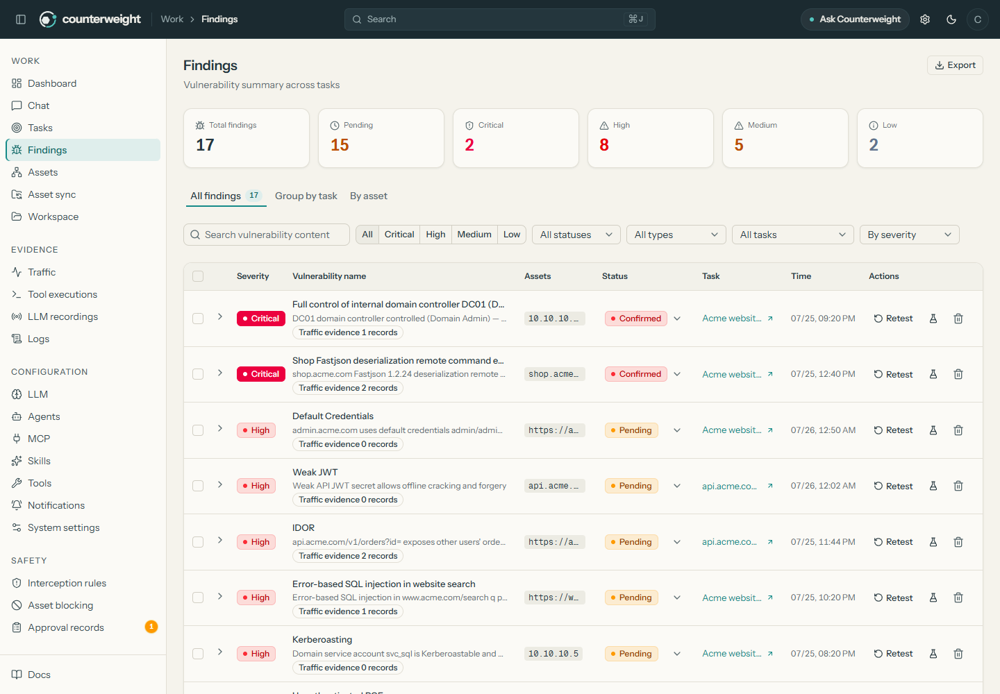 |

## Arquitectura

<!-- Generado por tools/build-architecture-diagram.mjs -->
<picture>
  <source media="(prefers-color-scheme: dark)" srcset="docs/brand/architecture-es-dark.svg" />
  
</picture>

El motor de planificador y workers y el modelo de dos grafos se explican en
[docs/architecture.md](docs/architecture.md) (en inglés).

## Configuración

La mayoría de las instalaciones solo necesita una base de datos y un modelo. Todo lo demás tiene un
valor predeterminado seguro.

| Ajuste | Dónde | Predeterminado |
| --- | --- | --- |
| Base de datos | `.env` (`POSTGRES_*`, Docker) · `config.json` o `COUNTERWEIGHT_PG_DSN` (nativo) | (obligatorio) |
| Modelo inicial | `ANTHROPIC_API_KEY`, `OPENAI_API_KEY`, `COUNTERWEIGHT_LLM_PROVIDER` / `_MODEL` / `_BASE_URL` / `_PROXY` | ninguno, se configura en **Modelos** |
| Dirección de la consola | `-addr` | `127.0.0.1:8787` |
| TLS de la consola | `-tls-cert`, `-tls-key` (Docker: `tls/server.pem`, `tls/server-key.pem`) | obligatorio fuera de loopback |
| Proxy de grabación | `-proxy` (vacío lo desactiva) | `127.0.0.1:8788` |
| Clientes del proxy | `COUNTERWEIGHT_PROXY_CLIENT_CIDRS` | solo loopback |
| Directorio de datos | `-data` | `data/` junto al binario |
| Confianza TLS hacia los objetivos | `-target-tls-ca`, `-target-tls-insecure-origins` | confianza de la plataforma |
| Agentes de trabajo por tarea | **Ajustes del sistema** | 3 |

Los flags pasan a través de los scripts de arranque, por ejemplo `./start.sh -addr 127.0.0.1:9000`.
Para acceder a la consola desde otras máquinas, sirve HTTPS:
`./start.sh -addr 0.0.0.0:8787 -tls-cert server.pem -tls-key server-key.pem`.

Referencia completa, con límites de almacenamiento y MCP remoto:
[docs/configuration.md](docs/configuration.md) (en inglés).

## Actualización

- **Binario publicado:** **Ajustes del sistema → Versión y actualizaciones** (*Version and
  updates*). La actualización se verifica con checksums y la versión anterior queda disponible para
  volver atrás con un clic.
- **Docker:** `git pull && docker compose up -d --build counterweight` (o `./update.sh`).
- **Código fuente:** `git pull && go run ./cmd/counterweight build` y luego reinicia.

Las migraciones de la base de datos se aplican solas al arrancar. Antes, respalda PostgreSQL y
`./data`; el esquema no vuelve atrás. Detalles y comandos de respaldo:
[docs/operations.md](docs/operations.md) (en inglés).

## Solución de problemas

<details>
<summary><b>Olvidé la contraseña de administrador</b></summary>

`./reset-password.sh -m docker` con Docker, o `./reset-password.sh -m local --backend ./counterweight`
en una instalación nativa. No hace falta reiniciar; las demás sesiones deben volver a iniciar
sesión.
</details>

<details>
<summary><b>El contenedor se detiene apenas arranca</b></summary>

Ejecuta `docker compose logs counterweight`. Lo habitual es que falte `tls/server.pem` o
`tls/server-key.pem`, o que sean inválidos, o que `POSTGRES_PASSWORD` no esté definido en `.env`.
</details>

<details>
<summary><b>El puerto 8787 u 8788 está ocupado</b></summary>

`start.sh` detiene un Counterweight anterior que siga ocupando sus puertos (y su supervisor, para
que no lo relance). Nunca detiene otro programa: si un servicio distinto usa un puerto, el lanzador
termina e indica cuál es. Elige puertos libres:
`./start.sh -addr 127.0.0.1:9000 -proxy 127.0.0.1:9001`. Con Docker, cambia el lado del host de
`ports:` en `docker-compose.yml`.
</details>

<details>
<summary><b>¿Puedo acceder a la consola desde otra computadora?</b></summary>

Sí, por HTTPS con un certificado válido para ese nombre de host (ver [Configuración](#configuración)).
HTTP simple solo se acepta en loopback. No expongas la consola a internet.
</details>

<details>
<summary><b>¿Funciona en Windows?</b></summary>

Sí: un `counterweight.exe` nativo con `start.bat`, o Docker Desktop con Git Bash o WSL para los
scripts. La ejecución por lotes en Windows todavía no se verificó de punta a punta (ver
[docs/VERIFICATION.md](docs/VERIFICATION.md)).
</details>

<details>
<summary><b>Las tareas nunca arrancan</b></summary>

Una tarea necesita un perfil de modelo activo. En **Modelos**, abre el perfil, haz clic en **Probar conexión** y lee la
sugerencia que se agrega a cualquier error.
</details>

Más respuestas: [docs/operations.md#troubleshooting](docs/operations.md#troubleshooting) (en inglés).

## Modelo de seguridad

Counterweight guarda material sensible (hallazgos, tráfico capturado, claves de API), por eso está
construido para protegerse a sí mismo además de probar a otros.

- **Fuera de la red por defecto.** HTTP simple solo en loopback; todo lo demás requiere TLS. Docker
  publica los puertos en `127.0.0.1`.
- **Una persona decide.** El alcance, las reglas de denegación, los objetivos bloqueados y la puerta
  de aprobación mantienen a los agentes dentro de los límites que fijas. El modelo no puede aprobar
  su propia excepción.
- **El acceso a archivos está confinado por tarea.** Con el aislamiento de ejecución activado (el
  valor por defecto), las herramientas de archivos de un agente no pueden salir de los archivos de
  su tarea, sea cual sea la ruta o el enlace que reciban. Una revisión de código va más lejos: sus
  agentes no tienen shell, escritura de archivos ni herramientas de red.
- **Las credenciales están protegidas en reposo y en uso.** Las credenciales guardadas se cifran con
  una clave que vive fuera de la base de datos, son de solo escritura en la consola, se ocultan a
  todo comando que ejecute un agente y nunca se envían a un modelo.
- **Sesiones que puedes terminar.** Cerrar sesión revoca la sesión en el servidor; cambiar la
  contraseña termina todas las sesiones.
- **La IA puede equivocarse.** Los hallazgos y las acciones pueden ser incompletos o inexactos.
  Verifica antes de actuar.

**Límites conocidos, dichos sin rodeos:**

- El aislamiento de ejecución es parcial. En el modo por defecto, los comandos y scripts de los
  tipos de evaluación que usan shell siguen ejecutándose con los privilegios del proceso de
  Counterweight. El modo contenedor opcional los mueve a un contenedor por tarea, pero hay que
  activarlo, funciona solo en instalaciones nativas (todavía no cuando Counterweight corre bajo
  Docker Compose), retiene algunas herramientas y se verificó solo en Docker Desktop para
  Windows. Ningún modo restringe el acceso a la red. Ejecuta Counterweight en un host, VM o
  contenedor dedicado que no contenga nada más de valor. Estado y trabajo pendiente:
  [docs/EXECUTION-ISOLATION.md](docs/EXECUTION-ISOLATION.md) (en inglés).
- Las revisiones de pull requests desde GitHub Actions necesitan un runner que alcance tu
  instancia, y todavía no se probaron en un workflow real.
- Las verificaciones de autorización prueban solo las peticiones listadas en la política, necesitan
  datos de prueba que ya existan, y se ejecutaron solo contra fixtures locales, no contra una
  aplicación real. El envío de peticiones por los agentes como un rol guardado se probó en una sola
  ejecución con un solo modelo, contra una aplicación local de demostración, y la limpieza de lo que
  reciben no puede detectar todas las formas en que un objetivo devuelva una credencial.
- Hay una sola cuenta de administrador: todavía no hay roles ni inicio de sesión único.
- La puerta de aprobación inspecciona la sintaxis de los comandos; reduce accidentes, pero no puede
  detectar todo comando equivalente.

El modelo completo, con autenticación, permisos de alcance, controles de destino y todos los límites
conocidos: [docs/security-model.md](docs/security-model.md) (en inglés). Para reportar una
vulnerabilidad en Counterweight, ver [SECURITY.md](SECURITY.md).

Counterweight se construye desde código revisado y no está afectado por las imágenes Docker de
terceros de ARTEX con puerta trasera reportadas en noviembre de 2026; ver la
[declaración](docs/advisories/2026-11-artex-docker-image.txt) (en inglés).

## Uso responsable

> [!WARNING]
> Counterweight está pensado **solo para autoevaluaciones de seguridad autorizadas**: sistemas,
> redes, aplicaciones y código fuente que te pertenecen, o que un tercero te autorizó a probar de
> antemano, de forma explícita y por escrito, dentro del alcance y el plazo de esa autorización.
> Probar sin permiso es ilegal en la mayoría de las jurisdicciones.

Los Términos de uso de la aplicación, que se aceptan al iniciar sesión, también prohíben:

- escanear, sondear, explotar o atacar cualquier sitio web, servicio, red o sistema sin la
  autorización explícita de su dueño, o más allá del alcance autorizado;
- ejecutar evaluaciones contra sistemas de producción salvo que el dueño haya aceptado
  explícitamente el riesgo operativo;
- intrusiones no autorizadas, robo de datos, extorsión, denegación de servicio o cualquier actividad
  destructiva o delictiva;
- quitar o eludir avisos de copyright, licencia o seguridad.

Empieza en un entorno
de laboratorio o staging, mantén activa la compuerta de aprobación y revisa el alcance, las reglas y
la configuración del modelo antes de cada evaluación.

## Documentación

La documentación detallada está en inglés.

| Tema | Documento |
| --- | --- |
| Toda la documentación | [docs/README.md](docs/README.md) |
| Referencia de configuración | [docs/configuration.md](docs/configuration.md) |
| Operación: actualizaciones, respaldos, contraseña | [docs/operations.md](docs/operations.md) |
| Guía de funciones | [docs/features.md](docs/features.md) |
| Elegir y conectar un modelo (alojado, local, propio) | [docs/choose-a-model.md](docs/choose-a-model.md) |
| Proveedores de modelos y gateways | [docs/llm-providers.md](docs/llm-providers.md) |
| Evaluación de ejemplo e informe de muestra | [docs/example-engagement.md](docs/example-engagement.md) |
| Modelo de seguridad | [docs/security-model.md](docs/security-model.md) |
| Reglas de la compuerta de aprobación | [docs/approval-gate.md](docs/approval-gate.md) |
| Aislamiento de ejecución (estado) | [docs/EXECUTION-ISOLATION.md](docs/EXECUTION-ISOLATION.md) |
| Revisiones de pull requests y la GitHub Action | [docs/pr-reviews.md](docs/pr-reviews.md) |
| Verificaciones de autorización desde un archivo de política | [docs/authorization-checks.md](docs/authorization-checks.md) |
| Verificación y limitaciones conocidas | [docs/VERIFICATION.md](docs/VERIFICATION.md) |
| Arquitectura | [docs/architecture.md](docs/architecture.md) |
| Adaptador para Claude Code, Codex y Pi | [adapters/agent/README.md](adapters/agent/README.md) |
| Procedencia y modificaciones | [docs/PROVENANCE.md](docs/PROVENANCE.md) |

## Contribuir

Las contribuciones son bienvenidas: reportes de errores, documentación, skills, pruebas y código.
Lee [CONTRIBUTING.md](CONTRIBUTING.md) para el entorno de desarrollo y las reglas de pruebas (las
pruebas de Go que usan la base de datos deben ejecutarse contra una base descartable cuyo nombre
termine en `_test`). Los problemas de seguridad se reportan según [SECURITY.md](SECURITY.md), no en
issues públicos.

## Agradecimientos

<p align="center">
  <a href="https://aisb.dev/">
    <picture>
      <source media="(prefers-color-scheme: dark)" srcset="docs/brand/aisb-on-dark.svg" />
      
    </picture>
  </a>
  &nbsp;&nbsp;&nbsp;&nbsp;&nbsp;&nbsp;
  <a href="https://www.anthropic.com/">
    <picture>
      <source media="(prefers-color-scheme: dark)" srcset="docs/brand/anthropic-on-dark.svg" />
      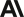
    </picture>
  </a>
</p>

Gracias al [AI Security Bootcamp (AISB)](https://aisb.dev/) y a
[Anthropic](https://www.anthropic.com/). A través de AISB, Anthropic ofreció a sus participantes seis
meses de Claude Pro para trabajo open source y sin fines comerciales, y gran parte de Counterweight se
construyó con esa suscripción. Un agradecimiento especial a Pranav Gade y al equipo de AISB por
hacerlo posible. Es un agradecimiento, no un respaldo: ninguna de las dos organizaciones mantiene ni
avala Counterweight.

Counterweight es mantenido por [PhiloCyber](https://github.com/Philocyber). Deriva de **ARTEX**, de
[Autumn-27](https://github.com/Autumn-27) (commit upstream `160fe13`), que aportó el motor de
planificador y workers y el modelo de exploración de dos grafos. Se conservan la autoría original y
el historial upstream; ver [NOTICE](NOTICE), [docs/PROVENANCE.md](docs/PROVENANCE.md) y
[CHANGELOG.md](CHANGELOG.md).

También se apoya en:

- [norma](https://github.com/Autumn-27/norma), el SDK de agentes;
- [ScopeSentry](https://github.com/Autumn-27/ScopeSentry), conceptos de sincronización de activos;
- [Dreadnode capabilities](https://github.com/dreadnode/capabilities) (MIT), skills adaptadas;
- [Cloudflare security-audit-skill](https://github.com/cloudflare/security-audit-skill) (MIT), base de
  la metodología de revisión de caja blanca;
- [AegisHook](https://github.com/RuoJi6/AegisHook), la vista de detalle de aprobaciones;
- [CyberStrikeAI](https://github.com/RuoJi6/CyberStrikeAI), guía para reportar hallazgos;
- [Cairn](https://github.com/oritera/Cairn), referencia.

## Licencia y descargo de responsabilidad

Counterweight se distribuye bajo la [GNU Affero General Public License v3.0](LICENSE). Puedes
usarlo, modificarlo y distribuirlo; si ejecutas una versión modificada y permites que otras
personas interactúen con ella a través de una red, debes ofrecerles el código fuente completo
correspondiente.

El software se entrega "tal cual", sin garantía de ningún tipo. Eres el único responsable de cómo lo
usas y de sus consecuencias. Los autores, colaboradores y mantenedores no supervisan su uso y no
son responsables de ningún daño que se derive de él. Los Términos de uso de la aplicación, aceptados
al iniciar sesión, se aplican además de la AGPL-3.0.
