<div align="center">

<picture>
  <source media="(prefers-color-scheme: dark)" srcset="docs/brand/counterweight-on-dark.svg" />
  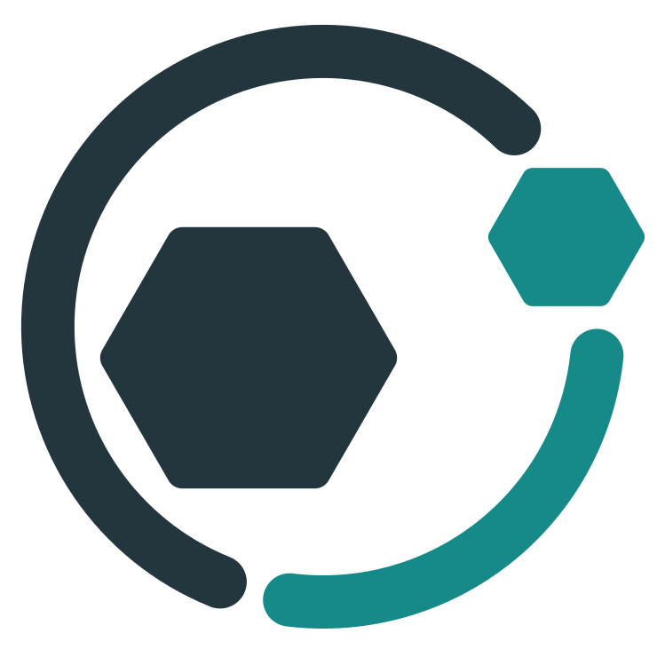
</picture>

# Counterweight

**Find and fix your weaknesses before an attacker does.**

Self-hosted, AI-assisted security assessments of your running applications and your source code:<br />
agents do the work, a person approves the risky steps, and every finding ends as a verified fix,<br />
a report your auditors can read and a ticket your developers can act on.

[](LICENSE)
[](go.mod)
[](https://github.com/Philocyber/counterweight/actions/workflows/ci.yml)
[](https://github.com/Philocyber/counterweight/releases)

**English** | [Español](README.es.md)

[Quickstart](#quickstart) · [First assessment](#your-first-assessment) · [Features](#features) · [Configuration](#configuration) · [Docs](#documentation) · [Responsible use](#responsible-use)

</div>

---

## Why Counterweight

Attackers are already automating with AI: cheap models and agent loops let a small crew probe an
organization more thoroughly than that organization has ever tested itself. Well-funded security
teams can keep up. Most companies cannot. They have no red team, no SOC and no pentest budget.

A counterweight restores balance to a lopsided system. This project puts the same class of tooling
on the defenders' side: open source, self-hosted, running on your machines with the model you
choose, so a two-person IT team or a growing startup can find and fix its weaknesses before someone
else does. ([More on the mission and its sources](docs/why-counterweight.md).)

<p align="center">
  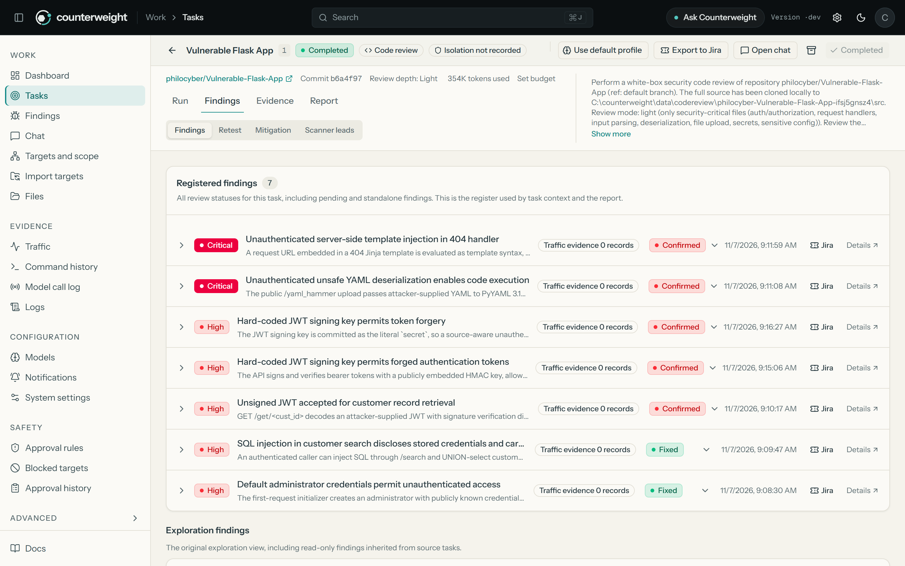
</p>

<details>
<summary><b>More from the same demo review</b> (fix pull request, exploration graph, report)</summary>
<br />

| Verified fix merged as a pull request | How the agents explored the code |
| :---: | :---: |
| 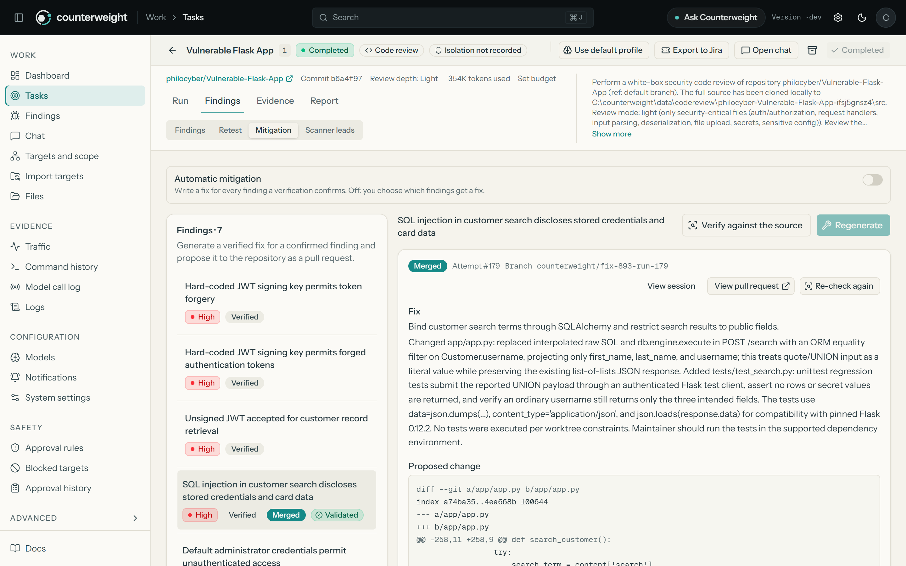 | 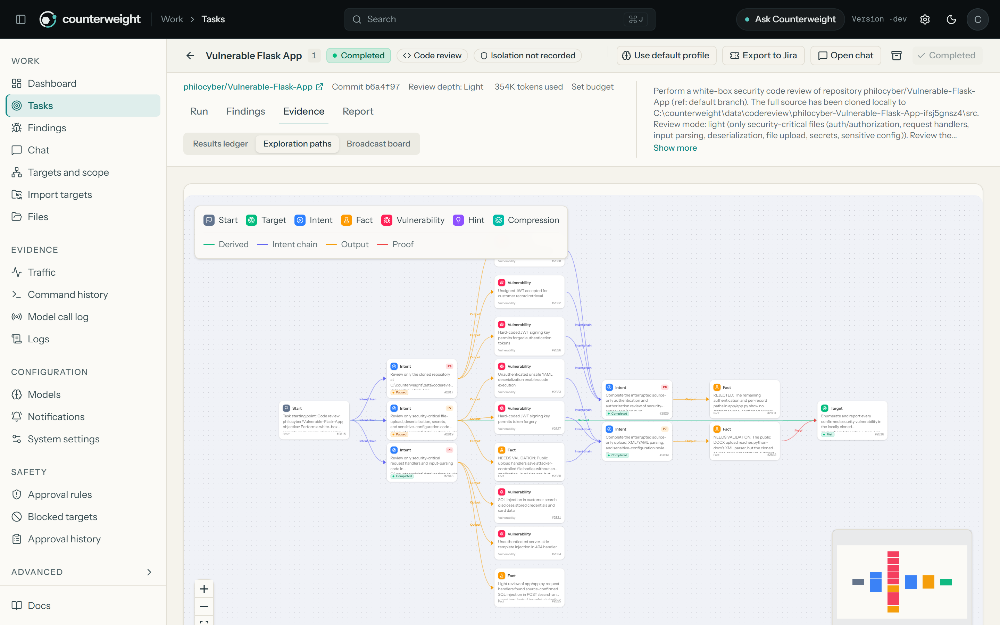 |

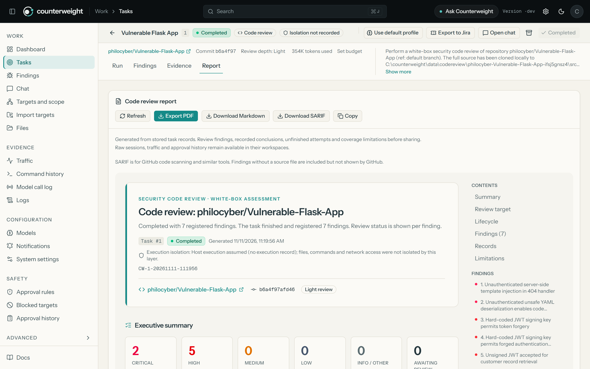

</details>

<p align="center"><sub>Demo: a white-box review of <a href="https://github.com/philocyber/Vulnerable-Flask-App">philocyber/Vulnerable-Flask-App</a>, an intentionally vulnerable training app. Model and host details are omitted.</sub></p>

<p align="center">
  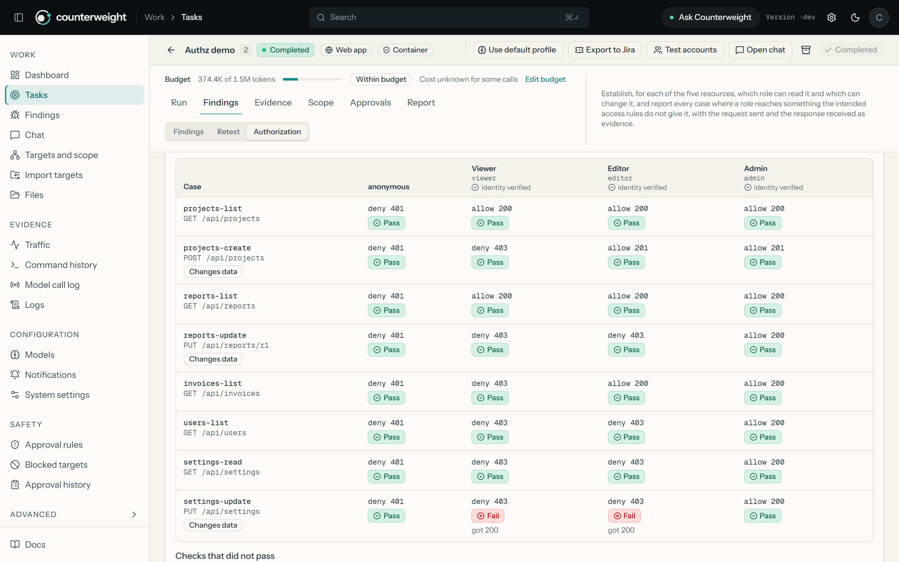
</p>

<details>
<summary><b>More from the web application demo</b> (test accounts by role, an agent testing as each role)</summary>
<br />

| Test accounts stored on the task, by role | An agent sending requests as each role |
| :---: | :---: |
| 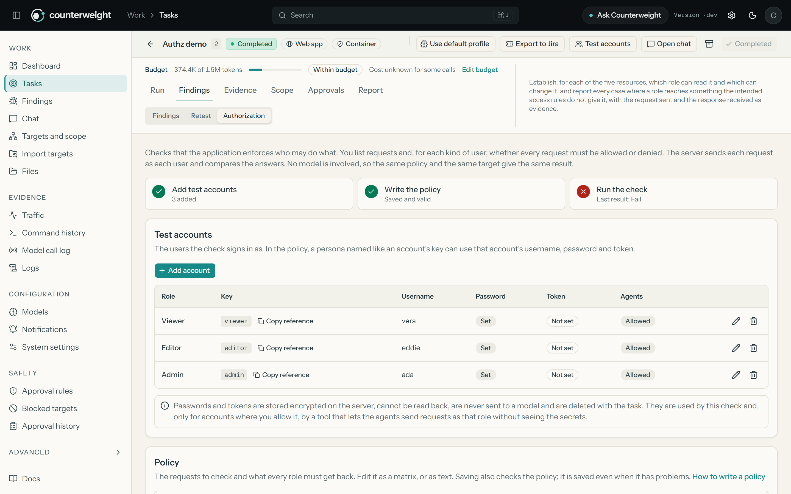 | 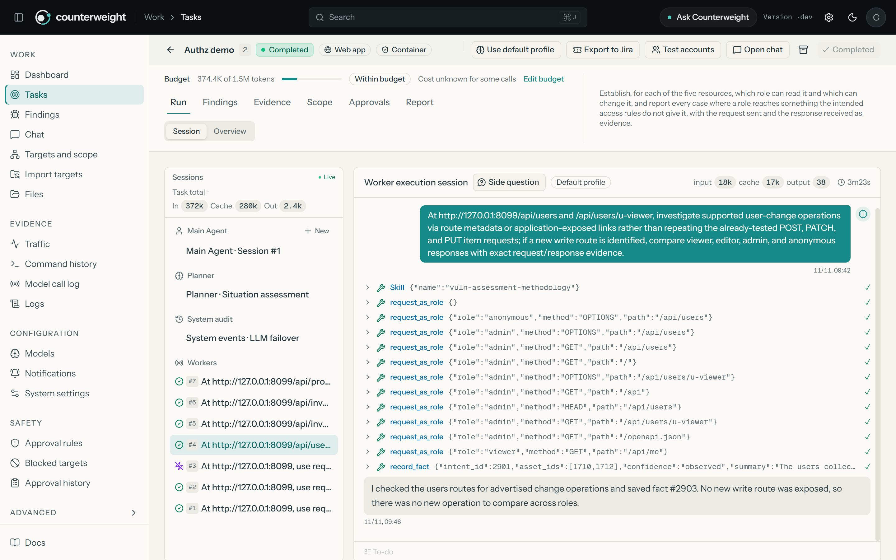 |

</details>

<p align="center"><sub>Demo: a local test application with five resources and three access levels. The authorization check, which uses no model, caught the flaw its policy lists; the agents, sending requests as each stored role without receiving its credentials, found two that it does not list.</sub></p>

## What it does

Counterweight covers the whole loop, not only the finding:

| Step | What happens |
| --- | --- |
| **Assess** | Choose what to test: a web application or API, a network, or a source repository. A planner and parallel workers explore it step by step. Each kind of assessment runs its own workflow, agents and tools. |
| **Prove** | With traffic capture on, black-box findings are bound to the captured HTTP traffic that demonstrates them. Code findings cite the file, the lines and the path from input to sink. A separate agent then tries to refute each one. |
| **Fix** | For code findings, one agent writes a patch, another reviews it, and Counterweight opens the pull request. After the merge it re-checks the merged code. |
| **Verify** | One-click retests answer *still reproducible*, *fixed* or *inconclusive* against the original evidence. |
| **Hand off** | Reports in Markdown and PDF (technical and executive), SARIF for GitHub code scanning, and Jira: one epic per assessment, one developer-ready issue per finding, kept up to date as fixes land. |

And it is built to be run by a small team, on its own machines:

- **You stay in charge.** Scope, deny rules and an approval gate hold risky commands until a person
  decides. A code review never executes the repository's code, and its agents have no shell or
  network tools at all.
- **Your data stays yours.** No hosted service and no telemetry. Use a hosted model, a gateway, or
  a model running on your own hardware, and nothing else leaves your network.
- **Hardened by default.** Agent file access is confined to each task, stored credentials are
  encrypted and write-only, sessions are revocable, and a per-task budget stops runaway spend.
- **Up in minutes.** One installer, a first-run checklist and a guided model setup take you from
  `git clone` to your first assessment.

## Quickstart

The quickest route is Docker Compose with the interactive installer. It takes a few commands; the
first image build compiles Counterweight from source and installs a headless browser, so expect it
to run for several minutes. Later starts take seconds.

**You need:** Git, [Docker](https://docs.docker.com/get-docker/) with Compose v2, a Bash shell
(Linux, macOS, or WSL / Git Bash on Windows), and an API key for a model provider (you can add it
later in the console).

**1. Get the code**

```bash
git clone https://github.com/Philocyber/counterweight.git
cd counterweight
```

**2. Install and start**

```bash
./install.sh        # choose 1) All-in-Docker install
```

The installer checks for Docker (and offers to install it on Linux), creates a self-signed HTTPS
certificate for `localhost` in `tls/` if you don't have one (the console is HTTPS-only under
Docker), asks for a PostgreSQL password (press Enter for a random one) and an optional Anthropic
API key, writes a private `.env`, builds the image and starts the stack. When the console answers,
it prints the address and the one-time setup token.

> [!TIP]
> Prefer no browser warning? Before running the installer, create a locally trusted certificate
> with [mkcert](https://github.com/FiloSottile/mkcert):
> `mkdir -p tls && mkcert -install && mkcert -cert-file tls/server.pem -key-file tls/server-key.pem localhost 127.0.0.1 ::1`.
> Using your own certificate is covered in [configuration](docs/configuration.md).

**3. Claim your installation.** Open **<https://localhost:8787>**. The first visit lands on the
setup page, which asks for the one-time token the installer printed. To print it again:

```bash
docker compose exec counterweight /app/counterweight -setup-token
```

In Git Bash on Windows, prefix that command with `MSYS_NO_PATHCONV=1` so the container path is not
rewritten. Paste the token, choose a password (at least 8 characters), accept the Terms of Use and
sign in as **`COUNTERWEIGHT`**.

<details>
<summary><b>Prefer to run Docker Compose by hand?</b></summary>

```bash
install -m 600 .env.example .env     # then set POSTGRES_PASSWORD (and optionally an API key)
# put a certificate in tls/server.pem and tls/server-key.pem first (see docs/configuration.md)
docker compose up -d --build
```

On Windows PowerShell, create the `.env` with a private ACL first:
`powershell.exe -NoProfile -File .\private-credential.ps1 -Path .\.env -Template .\.env.example`.

Compose publishes the console (`8787`) and the recording proxy (`8788`) on `127.0.0.1` only, and
keeps data in the `pgdata` volume plus the `./data` and `./skills` folders.
</details>

## Connect a model provider

Agents need a model. In the console open **Models → Connect a model**: choose where the model runs,
enter what that option needs, test the connection, and save. The first profile you save becomes the
active one. Templates fill in the format, base URL and model for you; nothing is contacted until you
test or save.

| Option | Typical use |
| --- | --- |
| **Anthropic** (Messages API) | Direct API key |
| **OpenAI** (Chat Completions or Responses API) | Direct API key |
| **Gateways**: Vercel AI Gateway, Amazon Bedrock API keys | One key, many models |
| **Z.ai GLM** templates | Direct API key |
| **Any OpenAI-compatible endpoint** | Local servers (Ollama, LM Studio, llama.cpp), self-hosted vLLM, or other providers |
| **Codex / ChatGPT sign-in** | Uses the Codex CLI on the backend host |

You can also bootstrap a default profile from `.env` with `ANTHROPIC_API_KEY` or `OPENAI_API_KEY`
(see [configuration](#configuration)).

Not sure which to pick, or want everything to stay on your machine?
[Choosing and connecting a model](docs/choose-a-model.md) compares hosted, gateway, local and
self-hosted inference, lists what the agents need from a model and ends with a five-minute check
that the one you chose really works. Provider templates, gateway setup and error hints:
[docs/llm-providers.md](docs/llm-providers.md).

> [!NOTE]
> Prompts, tool output and target data are sent to the model provider you configure, under that
> provider's terms. Counterweight itself has no hosted service and collects no usage data. Choose a
> provider, or a self-hosted model, that your data policy allows.

## Your first assessment

> [!IMPORTANT]
> Only assess systems and code you own or are explicitly authorized in writing to test. See
> [Responsible use](#responsible-use).

The **Get started** card on the dashboard walks you through these steps and ticks them off.

### Review the code of a GitHub repository

1. **Tasks → New task**, choose **Source code repository**, and enter `your-org/your-repo`. Pick a
   depth: `light` (security-critical files), `balanced` (default) or `comprehensive`. The same
   review can be started from **Chat** with `/code-review your-org/your-repo balanced`.
2. Counterweight clones the repository, records the exact commit and starts the review. Public
   repositories need nothing else; for a **private repository**, first add a fine-grained GitHub
   token with *Contents: read* on it under **System settings → Integrations**.
3. Follow the task. The review agents read and search the code; they cannot run it. When they
   finish, **Scanner leads** lists what the bundled dependency and secret scanners flagged, as
   leads the agents then verify, never as findings on their own.
4. In **Findings**, verify a finding against the source. Under **Mitigation**, generate a fix; a
   separate agent writes it and an automatic review checks it.
5. To propose the fix, give the token *Contents* and *Pull requests* read/write, then click
   **Open pull request**. After it is merged, **Re-check merged code** confirms the fix.

### Test a web application you are authorized to test

1. **Targets and scope**: create a company and add the exact hosts, IPs or CIDRs in scope.
2. **Approval rules**: review the built-in deny rules and enable interception for shell
   execution, so unmatched commands wait for your approval. To keep the HTTP exchanges behind each
   finding as evidence, turn on **Traffic capture** under **System settings → Data capture**.
3. **Tasks → New task**, choose **Web application or API**, describe what to test and one verifiable
   objective, for example *"Authorized assessment of staging.example.com: identify externally
   exposed weaknesses and report only what is confirmed with evidence."* Optionally set a token
   budget.
4. Watch the **Run** and **Evidence** tabs, and answer approvals as they arrive.
5. Triage **Findings** (bound traffic evidence included), use **Retest** after a fix, and export
   the **Report** as PDF, Markdown or SARIF, or send it to Jira from the task header.

A complete walkthrough with a sample report: [docs/example-engagement.md](docs/example-engagement.md).

## Installation

Docker Compose ([Quickstart](#quickstart)) is the recommended path. Two native options run without
containers; both need PostgreSQL and serve plain HTTP on `http://127.0.0.1:8787` (loopback only).

<details>
<summary><b>Release binary (Linux, macOS, Windows)</b></summary>

Download `counterweight-<version>-<os>-<arch>.zip` from
[Releases](https://github.com/Philocyber/counterweight/releases) and check it against
`SHA256SUMS`. Archives exist for Linux and macOS (amd64, arm64) and Windows (amd64). Each contains
the binary with the console embedded, `start.sh` (or `start.bat`), `skills/`, `config.example.json`,
the docs and the [agent adapter](adapters/agent/README.md).

No PostgreSQL yet? One container is enough:

```bash
docker run -d --name counterweight-pg -p 127.0.0.1:5432:5432 \
  -e POSTGRES_USER=counterweight -e POSTGRES_PASSWORD=change-me -e POSTGRES_DB=counterweight \
  -v counterweight-pg:/var/lib/postgresql/data postgres:16-alpine
```

Then configure and start:

```bash
install -m 600 config.example.json config.json   # set host, port (5432), user, password, dbname
./start.sh                                       # Windows: .\start.bat (keeps running)
```

In a second terminal, print the one-time setup token and open <http://127.0.0.1:8787>:

```bash
./counterweight -setup-token                     # Windows: .\counterweight.exe -setup-token
```

On Windows, create `config.json` with
`powershell.exe -NoProfile -File .\private-credential.ps1 -Path .\config.json -Template .\config.example.json`.
Instead of `config.json` you can set `COUNTERWEIGHT_PG_DSN`. Always start through `start.sh` /
`start.bat`: they run the restart loop that in-app updates rely on.
</details>

<details>
<summary><b>Build from source</b></summary>

Requires Go 1.26.3+ (see `go.mod`) and Node.js 22 with npm.

```bash
go run ./cmd/counterweight build      # builds the console and ./counterweight (counterweight.exe on Windows)
./start.sh                            # Windows: .\start.bat
```

`./install.sh` option **2) Local run** does the same interactively and can start PostgreSQL in Docker
for you. Cross-platform release archives: `./build.sh --release`. Development setup:
[CONTRIBUTING.md](CONTRIBUTING.md).
</details>

## Features

**Assess**
- Four assessment types (web application or API, network and hosts, source code repository,
  mixed), each with its own workflow, agents, tools and report.
- Multi-agent engine: a planner and N parallel workers (3 per task by default) share an asset graph
  and an exploration graph, so multi-step work stays coherent across sessions.
- White-box review of public and private GitHub repositories at three depths, by agents that can
  read and search the code but cannot execute it or reach the network.
- Supplementary scanners for code reviews (dependency advisories with OSV-Scanner, committed secrets
  with Gitleaks). They never steer the review: the agents finish their own work first, then verify
  the scanner leads, and are never told when a scanner found nothing.
- Pull request reviews: review only what a change introduces, from the console or from a GitHub
  Actions workflow that reports to the job summary, code scanning and the pull request, and can
  fail the job on findings inside the changed lines ([guide](docs/pr-reviews.md)).
- Authorization checks without a model: a policy states which role may send which request and what
  each must get back, and Counterweight replays it against staging. Run it inside a task, with test
  accounts stored encrypted on the task, the policy filled in as a matrix of requests and roles
  (or written as text) and the result by role name in the task report, or from a
  CI job with `counterweight authz`, which fails when a route opens to the wrong user. Credentials
  stay out of every output. You can also let the agents send requests as a stored role: the server
  signs in for them and they never receive the credentials
  ([guide](docs/authorization-checks.md)).
- A chat agent that can create tasks, start reviews and answer questions about results.

**Stay in control**
- Task scope with operator-approved coverage proposals, and global and per-task blocked targets.
- Built-in deny rules for destructive commands, plus your own allow and deny rules.
- Approval gate: unmatched shell executions wait for a human; the model cannot approve itself, a
  failed automatic review asks a person, and a five-minute timeout denies. Permission holds pause
  the task and survive restarts.
- Per-task budget in tokens, or in money when you enter your model's prices: the task pauses at the
  limit and continues when you raise it.

**Evidence**
- Recording proxy (off until you turn on traffic capture) that captures agent HTTP(S) traffic and
  binds it to findings with roles and notes.
- Full activity trail: sessions, command history, model call log and logs.
- Every report states how the task ran, including whether file access was confined.

**Fix and verify**
- One-click retests by a dedicated agent.
- Independent verification, fix generation with patch review, pull requests and post-merge re-check
  for code findings.

**Report and hand off**
- Task reports in Markdown and PDF (technical and executive variants, credentials redacted).
- SARIF 2.1.0 export for GitHub code scanning and other tools, with CWE tags and stable
  fingerprints ([how to upload](docs/features.md)).
- Jira Cloud: file a task as an epic and its findings as developer-ready issues in one click, in the
  space you choose, with priorities and due dates by severity; Counterweight comments and
  transitions the issues as fixes are merged and re-checked ([guide](docs/jira.md)).
- Findings export to Markdown, ZIP, CSV and JSON.

**Secure by design**
- Execution isolation, on by default: the file tools of every task agent are confined to that
  task's own files, checked by a self-test at startup, and the task does not start if the check
  fails.
- Optional container mode for native installs: each task's commands run in its own unprivileged
  container that cannot see the server's environment, credentials or other tasks' files, proven
  by a self-test against a real container before the mode can be selected.
- API tokens for automation that reach only the review endpoints, stored as a hash, revocable.
- Integration and model credentials are write-only in the console and encrypted in the database
  with a key kept outside it.
- Revocable sessions, sign out everywhere, one-time tickets for live streams, browser security
  headers and a minimum password length.
- Updates are checksum-verified, and signature-verified (Ed25519) in builds that embed the
  project's release key; a failed update rolls back automatically.

**Extend**
- Skills library (`agentskills.io` format), custom command/script/HTTP tools, local and remote MCP
  servers, notifications, asset import from [ScopeSentry](https://github.com/Autumn-27/ScopeSentry),
  and an adapter for Claude Code, Codex and Pi.

**Operate**
- One Go binary with the console embedded, or Docker Compose with an installer that prints the
  address and the one-time setup token.
- A first-run checklist, a guided model setup and complete in-app documentation.
- Console in English and Spanish (backend messages and reports are in English).

More detail: [docs/features.md](docs/features.md).

| Tasks | Findings |
| :---: | :---: |
| 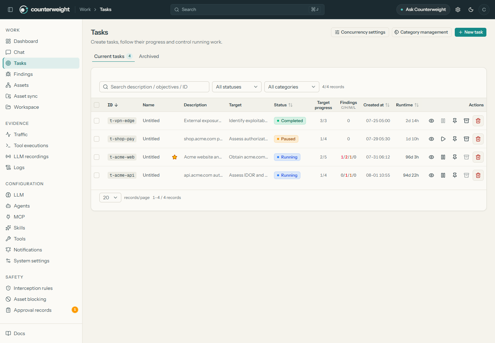 | 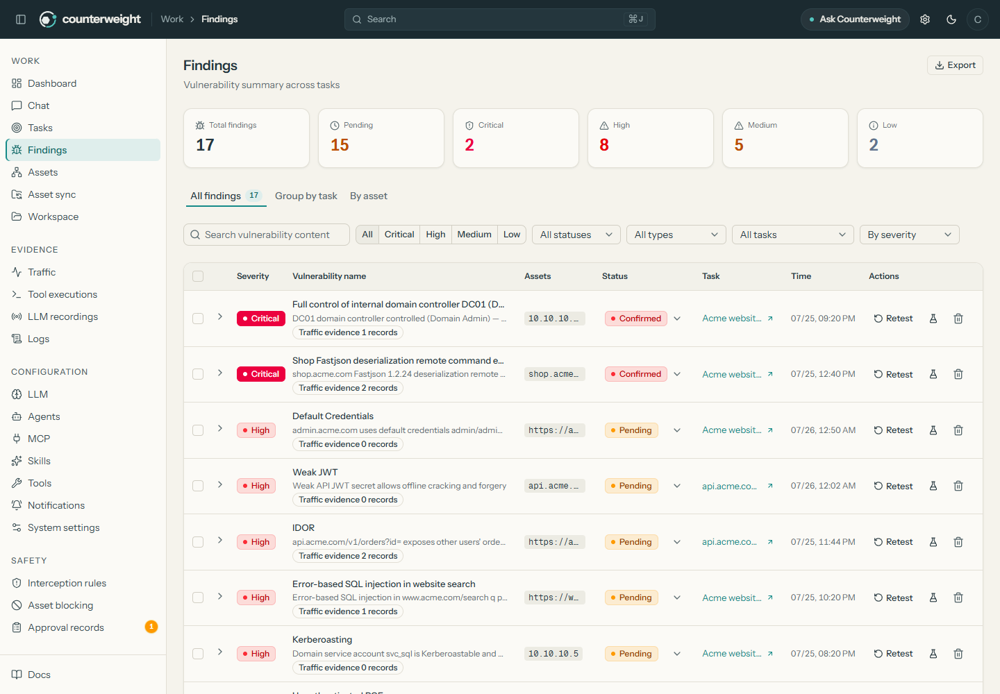 |

## Architecture

<!-- Generated by tools/build-architecture-diagram.mjs -->
<picture>
  <source media="(prefers-color-scheme: dark)" srcset="docs/brand/architecture-en-dark.svg" />
  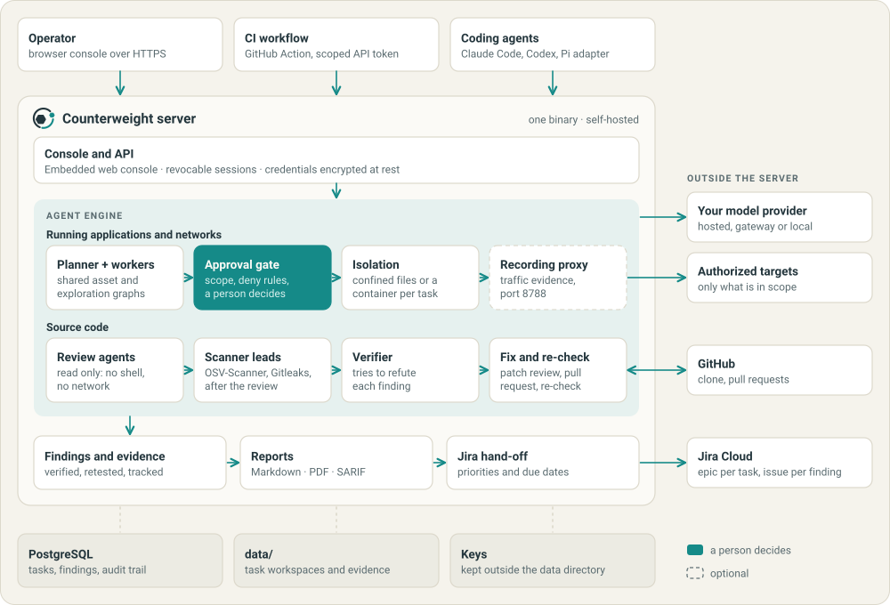
</picture>

The planner/worker engine and the two-graph model are explained in
[docs/architecture.md](docs/architecture.md).

## Configuration

Most installs only need a database and a model. Everything else has a safe default.

| Setting | Where | Default |
| --- | --- | --- |
| Database | `.env` (`POSTGRES_*`, Docker) · `config.json` or `COUNTERWEIGHT_PG_DSN` (native) | (required) |
| Model bootstrap | `ANTHROPIC_API_KEY`, `OPENAI_API_KEY`, `COUNTERWEIGHT_LLM_PROVIDER` / `_MODEL` / `_BASE_URL` / `_PROXY` | none, configure in **Models** |
| Console address | `-addr` | `127.0.0.1:8787` |
| Console TLS | `-tls-cert`, `-tls-key` (Docker: `tls/server.pem`, `tls/server-key.pem`) | required off loopback |
| Recording proxy | `-proxy` (empty disables it) | `127.0.0.1:8788` |
| Proxy clients | `COUNTERWEIGHT_PROXY_CLIENT_CIDRS` | loopback only |
| Data directory | `-data` | `data/` next to the binary |
| Upstream TLS trust | `-target-tls-ca`, `-target-tls-insecure-origins` | platform trust |
| Work agents per task | **System settings** | 3 |

Flags pass through the start scripts, for example `./start.sh -addr 127.0.0.1:9000`. To reach the
console from other machines, serve HTTPS:
`./start.sh -addr 0.0.0.0:8787 -tls-cert server.pem -tls-key server-key.pem`.

Full reference, including storage limits and remote MCP: [docs/configuration.md](docs/configuration.md).

## Updating

- **Release binary:** **System settings → Version and updates**. The update is checksum-verified,
  and the previous version is kept for one-click rollback.
- **Docker:** `git pull && docker compose up -d --build counterweight` (or `./update.sh`).
- **Source:** `git pull && go run ./cmd/counterweight build`, then restart.

Database migrations run automatically on start. Back up PostgreSQL and `./data` first; the schema
does not roll back. Details and backup commands: [docs/operations.md](docs/operations.md).

## Troubleshooting

<details>
<summary><b>I forgot the admin password</b></summary>

`./reset-password.sh -m docker` for Docker, or `./reset-password.sh -m local --backend ./counterweight`
for a native install. No restart needed; other sessions must sign in again.
</details>

<details>
<summary><b>The container stops right after starting</b></summary>

Run `docker compose logs counterweight`. Usually `tls/server.pem` or `tls/server-key.pem` is missing
or invalid, or `POSTGRES_PASSWORD` is not set in `.env`.
</details>

<details>
<summary><b>Port 8787 or 8788 is taken</b></summary>

`start.sh` stops an earlier Counterweight that still holds its ports (and its supervisor, so it does
not relaunch). It never stops another program: if a different service uses a port, the launcher
exits and names it. Pick free ports:
`./start.sh -addr 127.0.0.1:9000 -proxy 127.0.0.1:9001`. For Docker, change the host side of
`ports:` in `docker-compose.yml`.
</details>

<details>
<summary><b>Can I reach the console from another computer?</b></summary>

Yes, over HTTPS with a certificate valid for that hostname (see [Configuration](#configuration)).
Plain HTTP is accepted on loopback only. Do not expose the console to the internet.
</details>

<details>
<summary><b>Does it work on Windows?</b></summary>

Yes: a native `counterweight.exe` with `start.bat`, or Docker Desktop with Git Bash or WSL for the
scripts. Windows batch execution has not been verified end to end yet (see
[docs/VERIFICATION.md](docs/VERIFICATION.md)).
</details>

<details>
<summary><b>Tasks never start</b></summary>

A task needs an active model profile. In **Models**, open the profile, click **Test connection** and read the hint
appended to any error.
</details>

More answers: [docs/operations.md#troubleshooting](docs/operations.md#troubleshooting).

## Security model

Counterweight holds sensitive material (findings, captured traffic, API keys), so it is built to
protect itself as well as to test others.

- **Off the network by default.** Plain HTTP only on loopback; anything else requires TLS. Docker
  binds ports to `127.0.0.1`.
- **A human decides.** Scope, deny rules, blocked targets and the approval gate keep agents inside
  the boundaries you set. The model cannot approve its own fallback.
- **File access is confined per task.** With execution isolation on (the default), an agent's file
  tools cannot leave its task's own files, whatever path or link it is given. A code review goes
  further: its agents have no shell, no file writes and no network tools.
- **Credentials are protected at rest and in use.** Stored credentials are encrypted with a key
  outside the database, write-only in the console, masked from every command an agent runs, and
  never sent to a model.
- **Sessions you can end.** Signing out revokes the session on the server; changing the password
  ends every session.
- **AI can be wrong.** Findings and actions may be incomplete or inaccurate. Verify before acting.

**Known limits, stated plainly:**

- Execution isolation is partial. In the default mode, commands and scripts of assessment types
  that use a shell still run with the privileges of the Counterweight process. The optional
  container mode moves them into a per-task container, but it is opt-in, works on native installs
  only (not yet when Counterweight itself runs under Docker Compose), withholds some tools, and
  has been verified on Docker Desktop for Windows only. No mode restricts network access. Run
  Counterweight on a dedicated host, VM or container with nothing else of value. Status and
  remaining work: [docs/EXECUTION-ISOLATION.md](docs/EXECUTION-ISOLATION.md).
- Pull request reviews from GitHub Actions need a runner that can reach your instance, and have
  not been exercised in a real workflow yet.
- Authorization checks test only the requests listed in the policy, need test data that already
  exists, and have been run against local fixtures only, not against a real application. Agents
  sending requests as a stored role has been exercised in one run with one model, against a local
  demo application, and the cleaning of what they receive cannot catch every form a target may
  return a credential in.
- There is one administrator account: no roles and no single sign-on yet.
- The approval gate inspects command syntax; it reduces accidents and cannot catch every
  equivalent command.

The full model, including authentication, scope grants, destination checks and every known limit:
[docs/security-model.md](docs/security-model.md). To report a vulnerability in Counterweight, see
[SECURITY.md](SECURITY.md).

Counterweight is built from reviewed source and is not affected by the backdoored third-party ARTEX
Docker images reported in November 2026; see the [statement](docs/advisories/2026-11-artex-docker-image.txt).

## Responsible use

> [!WARNING]
> Counterweight is intended **only for authorized security self-assessments**: systems, networks,
> applications and source code that you own, or that a third party has authorized you in advance,
> explicitly and in writing, to test, within the scope and time window of that authorization.
> Testing without permission is illegal in most jurisdictions.

The in-app Terms of Use, accepted at sign-in, also prohibit:

- scanning, probing, exploiting or attacking any website, service, network or system without its
  owner's explicit authorization, or beyond the authorized scope;
- running engagements against production systems unless the owner has explicitly accepted the
  operational risk;
- unauthorized intrusion, data theft, extortion, denial of service, or any destructive or criminal
  activity;
- removing or circumventing copyright, license or safety notices.

Start in a lab or staging environment, keep the approval gate on, and review scope, rules and model
settings before every engagement.

## Documentation

| Topic | Document |
| --- | --- |
| All documentation | [docs/README.md](docs/README.md) |
| Configuration reference | [docs/configuration.md](docs/configuration.md) |
| Operations: updates, backups, password reset | [docs/operations.md](docs/operations.md) |
| Feature guide | [docs/features.md](docs/features.md) |
| Choosing and connecting a model (hosted, local, self-hosted) | [docs/choose-a-model.md](docs/choose-a-model.md) |
| Model providers and gateways | [docs/llm-providers.md](docs/llm-providers.md) |
| Example engagement and sample report | [docs/example-engagement.md](docs/example-engagement.md) |
| Security model | [docs/security-model.md](docs/security-model.md) |
| Approval gate rules | [docs/approval-gate.md](docs/approval-gate.md) |
| Execution isolation (status) | [docs/EXECUTION-ISOLATION.md](docs/EXECUTION-ISOLATION.md) |
| Pull request reviews and the GitHub Action | [docs/pr-reviews.md](docs/pr-reviews.md) |
| Authorization checks from a policy file | [docs/authorization-checks.md](docs/authorization-checks.md) |
| Verification and known limitations | [docs/VERIFICATION.md](docs/VERIFICATION.md) |
| Architecture | [docs/architecture.md](docs/architecture.md) |
| Claude Code, Codex and Pi adapter | [adapters/agent/README.md](adapters/agent/README.md) |
| Provenance and modifications | [docs/PROVENANCE.md](docs/PROVENANCE.md) |

## Contributing

Contributions are welcome: bug reports, documentation, skills, tests and code. Read
[CONTRIBUTING.md](CONTRIBUTING.md) for the development setup and the test rules (Go database tests
must run against a disposable database whose name ends in `_test`). Security issues go through
[SECURITY.md](SECURITY.md), not public issues.

## Acknowledgements

Counterweight is maintained by [PhiloCyber](https://github.com/Philocyber). It is derived from
**ARTEX** by [Autumn-27](https://github.com/Autumn-27) (upstream commit `160fe13`), which provided its
planner/worker engine and two-graph exploration model. Original authorship and upstream history are
retained; see [NOTICE](NOTICE), [docs/PROVENANCE.md](docs/PROVENANCE.md) and [CHANGELOG.md](CHANGELOG.md).

It also builds on:

- [norma](https://github.com/Autumn-27/norma), the agent SDK;
- [ScopeSentry](https://github.com/Autumn-27/ScopeSentry), asset-sync concepts;
- [Dreadnode capabilities](https://github.com/dreadnode/capabilities) (MIT), adapted skills;
- [Cloudflare security-audit-skill](https://github.com/cloudflare/security-audit-skill) (MIT), the
  basis of the white-box review methodology;
- [AegisHook](https://github.com/RuoJi6/AegisHook), the approval-detail view;
- [CyberStrikeAI](https://github.com/RuoJi6/CyberStrikeAI), finding-reporting guidance;
- [Cairn](https://github.com/oritera/Cairn), reference.

## License and disclaimer

Counterweight is licensed under the [GNU Affero General Public License v3.0](LICENSE). You may use,
modify and distribute it; if you run a modified version and let users interact with it over a
network, you must offer them the complete corresponding source code.

The software is provided "as is", without warranty of any kind. You are solely responsible for how
you use it and for its consequences. The authors, contributors and maintainers do not supervise its
use and are not liable for any damage arising from it. The in-app Terms of Use, accepted at sign-in,
apply in addition to the AGPL-3.0.
