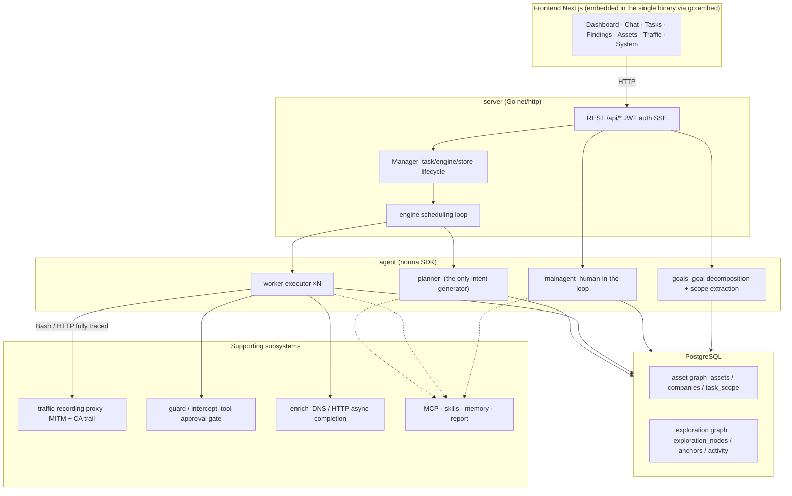
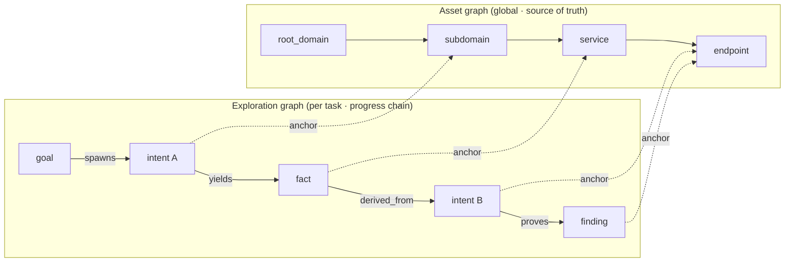
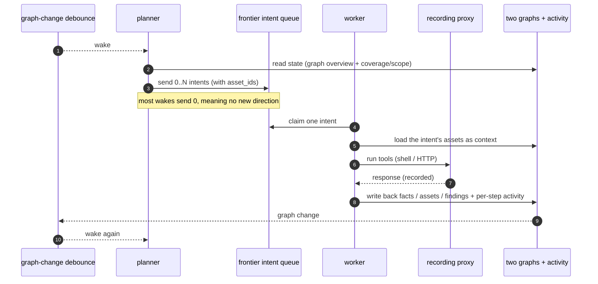
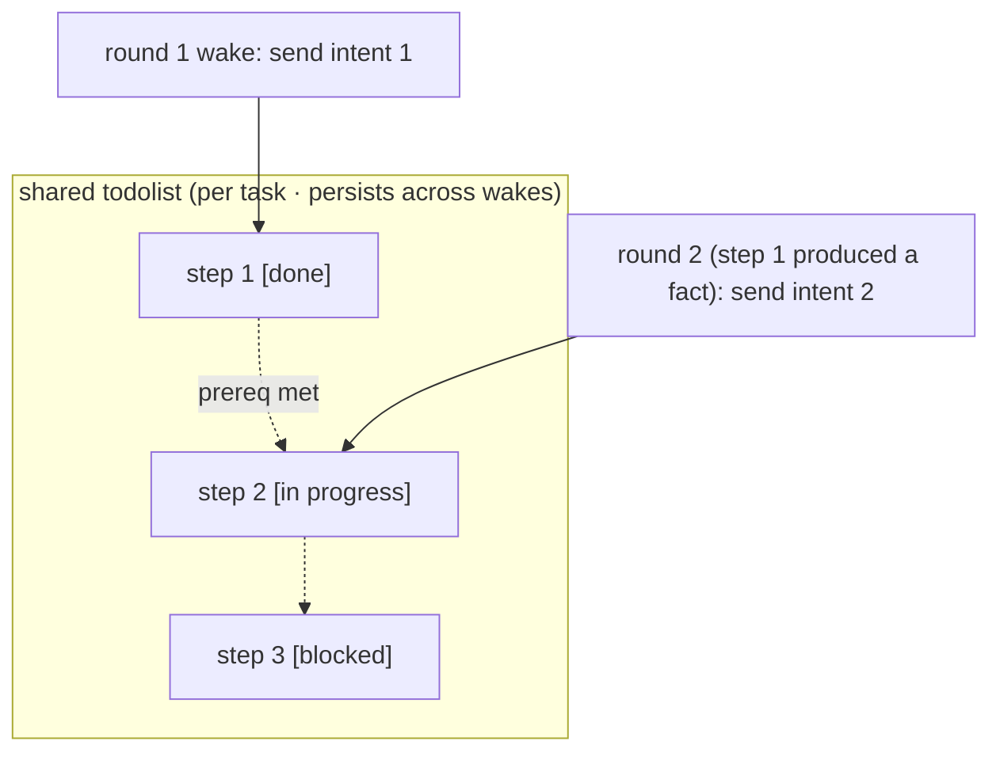

# Architecture

Counterweight is a single Go backend, with the Next.js console embedded through `go:embed`, plus
PostgreSQL. Agent capabilities come from the [`norma`](https://github.com/Autumn-27/norma) SDK
(`agentcore` / `tool` / `permission` / `harness` / `memory` / `transcript`). The planner/worker
engine and the two-graph exploration model come from the upstream ARTEX project (see
[PROVENANCE.md](PROVENANCE.md)).

The core is a **two-graph architecture**, with two autonomy mechanisms around it:
**process-level information exchange between workers** and a **planner's shared multi-round
todolist that keeps an attack chain stable**.

## Layers

| Layer | Responsibility |
| --- | --- |
| **Frontend** | Next.js static export embedded in the binary; visualizes tasks, assets, exploration and coverage, and hosts the human-in-the-loop chat |
| **server** | `net/http` routing, JWT auth and SSE; `Manager` owns the lifecycle of tasks, engines and stores |
| **engine** | One `plannerLoop` plus N worker goroutines per task; intent claiming, timeout, pause and drain |
| **agent** | goals / planner / worker / mainagent; the `ToolSet` exposes the two graphs as model tools |
| **db** | PostgreSQL (pgx) for both graphs; the schema is embedded and applied idempotently on every start |
| **support** | Recording MITM proxy, approval gate, async enrichment, MCP, skills, memory and reports |

Traffic evidence is stored separately in SQLite under the data directory, with its own storage
limits (see [configuration.md](configuration.md#traffic-storage-limits)).

## Two graphs: exploration and assets

The system separates **what the target is** from **how far it has been tested**:

- **Asset graph (global, shared)**: the single source of truth for assets across tasks. Nodes are
  `root_domain / subdomain / ip / service / app / endpoint`, each owned by a company. Parent/child
  relationships and deduplication keys are computed by the program; agents only submit raw
  observations.
- **Exploration graph (per task)**: the reasoning and progress of one task. Nodes are
  `goal / intent / fact / finding / hint`, linked by `spawns / derived_from / yields / proves` edges
  into a lineage chain that answers "which direction came from which facts, and what did it
  produce".
- **Anchors connect them**: `exploration_anchors(node_id, asset_id)` ties an intent, fact or finding
  to an asset. This drives **asset test coverage** and the **asset coverage graph**.

Division of labor: the **planner** reads the exploration graph, judges the goal, and sends an
**intent** only when there is an uncovered direction. A **worker** claims one intent, runs real
tools, writes new assets, facts and findings back to both graphs, and stops.

## Engine loop

The engine is event-driven: a graph change wakes the planner, the planner sends intents, a worker
claims one, executes and writes back, and the write-back triggers the next round, until the goal is
proven (`prove_goal`).

Most planner wake-ups send no new intent. That means there is nothing new to try, not that
something is wrong.

## Sharing observations between workers

Useful observations often appear in one worker's execution without being recorded as a formal
fact. Workers can search each other's execution traces within the same task:

- `search_all_worker_traces(q)`: keyword search across other workers' steps in this task (the
  caller's own intent is excluded); hits carry an `intent_id`.
- `list_worker_traces` / `get_worker_trace(intent_id, step_ids=[...])`: list runs, then read the
  full content of specific steps.

Each worker still executes only the one intent it claimed.

## The planner's shared todolist

Multi-step work has dependencies; sending every step in parallel causes chaos. The planner keeps a
todolist per task that persists across wake-ups. Each wake is a fresh session, so the list lets the
planner record a dependent sequence once and release the next step only when its prerequisites are
done and the facts it depends on exist.

## White-box code review

A code review task clones a GitHub repository (anonymously, or with the stored GitHub token when
the anonymous clone fails, which is how private repositories are reached) into the data directory (`codereview/`),
records the exact commit, and runs the same planner/worker engine over the source with the bundled
`whitebox-code-review-methodology` skill. Depth is `light` (security-critical files only),
`balanced` (default) or `comprehensive` (all files). Findings can then be verified independently,
fixed by a separate fixer agent with an automatic patch review, proposed as a pull request with
your GitHub token, and re-checked against the merged code.
